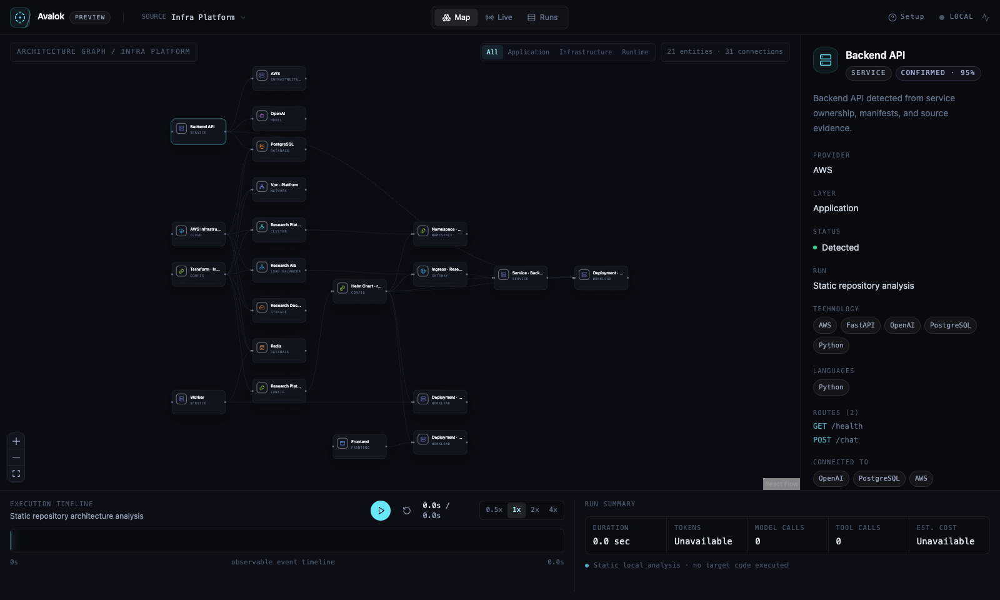

# Avalok

**See your whole system.**

Avalok is a local-first visual system for understanding how your code, infrastructure, agents, and runtime connect and execute. It maps your repository's architecture statically, then overlays what actually ran: coding-agent sessions, OpenTelemetry traces, and agent tool calls, all on one canvas on your machine.



> **Developer preview (`0.1.0-alpha.1`).** Avalok is not published to npm yet. The Quick Start shows the command that will work after publication and how to try the release candidate today.

## Quick Start

Requires Node.js **22.12 or newer** (tested on Node 22 LTS and Node 24 LTS). Building from a clone needs Node 24.19 (see [CONTRIBUTING](CONTRIBUTING.md)).

**After publication** (not available yet):

```sh
npx avalok            # analyze the current directory and open the dashboard
# or
npm install -g avalok
avalok .
```

**Today: build and try the release candidate** from a clone of this repository (needs pnpm 11.19):

```sh
pnpm install --frozen-lockfile
pnpm release:build --skip-smoke          # → artifacts/release/avalok-0.1.0-alpha.1.tgz
npm install -g ./artifacts/release/avalok-0.1.0-alpha.1.tgz
cd /path/to/your/repository
avalok .
```

Avalok analyzes the repository, starts a dashboard at `http://127.0.0.1:4737` and a local OTLP receiver at `http://127.0.0.1:4318`, and opens your browser. If a local Codex or Claude Code session ran in this repository, the newest one opens straight away over the architecture map; otherwise you see the map and a list of sessions to pick from. Avalok asks for no permission and sends nothing anywhere. Press Ctrl+C to stop.

No repository or agent session handy? `avalok demo` opens the built-in demo.

```sh
avalok demo           # open the built-in demo
avalok doctor         # check the setup without starting anything
avalok --help
avalok data path      # where Avalok keeps its own data
avalok data clear     # delete Avalok's runs and settings
```

## What Avalok sees

| Layer              | How                                                                                                                  |
| ------------------ | -------------------------------------------------------------------------------------------------------------------- |
| **Architecture**   | Static analysis of source and configuration files: services, routes, model/tool/datastore integrations, dependencies |
| **Infrastructure** | Terraform, Kubernetes, Helm, Docker, and Compose files, parsed as data, including inferred AWS relationships         |
| **Agents**         | Local Codex sessions; Claude Code through its OpenTelemetry traces and opt-in lifecycle hooks                        |
| **Runtime**        | OpenTelemetry traces (OTLP/HTTP protobuf or JSON), with OpenInference semantics for LLM, tool, and retrieval spans   |

Every detected element carries **evidence** (the file and reason it was detected) and a **confidence** level. Avalok reports what it detected and observed; it does not claim complete understanding of your system.

### Architecture

Avalok parses JavaScript/TypeScript (TypeScript compiler API, syntax only) and Python (`@lezer/python`) without importing, running, or installing anything from your repository. It groups code into service units (workspace packages, Python projects, container build contexts) and shows the system at service level. Files appear in the inspector, not as thousands of nodes.

### Live runtime

Runtime activity is normalized into one event model and replayed on the same canvas: Map, Live, and Runs views; a timeline with seek and speed; an inspector with raw and normalized data. Reconciliation matches runtime activity to architecture entities by path, workspace ownership, and route or integration identity. Anything it cannot match (terminal commands, model calls, MCP tools) stays visible instead of being forced into a match.

### Infrastructure intelligence

Terraform (HCL and JSON), Kubernetes manifests, Helm charts (bounded static values substitution), Dockerfiles, and Compose files are parsed as data. Avalok infers AWS resource relationships and links application services to their configured deployment (container → Kubernetes workload → cluster → cloud).

**This is configured architecture, not live state.** Avalok does **not** connect to AWS APIs, Kubernetes clusters, CloudWatch, Prometheus, or cost services. It never runs `terraform`, `helm`, `kubectl`, or cloud CLIs, and never reads `.tfvars` or Terraform state; Kubernetes Secret and secret-like configuration values are discarded.

## Supported sources

| Source                                               | Static architecture | Runtime observation | Configuration inference | Notes                                                            |
| ---------------------------------------------------- | :-----------------: | :-----------------: | :---------------------: | ---------------------------------------------------------------- |
| JavaScript / TypeScript                              |          ✓          |  via OpenTelemetry  |            —            | Imports, routes, AI SDK, datastore and HTTP integrations         |
| Python                                               |          ✓          |  via OpenTelemetry  |            —            | FastAPI, Flask, Django routes; PEP 621, Poetry, requirements     |
| Docker                                               |          ✓          |          —          |            ✓            | Dockerfile structure, ports, build ownership                     |
| Docker Compose                                       |          ✓          |          —          |            ✓            | Services, dependencies, ports; environment values discarded      |
| Terraform                                            |          ✓          |          —          |            ✓            | Resources and references; no state, `.tfvars`, or providers      |
| Kubernetes                                           |          ✓          |          —          |            ✓            | Multi-document manifests; Secret values discarded (keys only)    |
| Helm                                                 |          ✓          |          —          |            ✓            | Direct `.Values` substitution only; no `helm template`           |
| AWS                                                  |          —          |          —          | ✓ (from configuration)  | Inferred from Terraform/Kubernetes; no AWS API access            |
| Codex                                                |          —          |          ✓          |            —            | Local session files: history and live tailing, read-only         |
| Claude Code                                          |          —          |          ✓          |            —            | Its OpenTelemetry traces and opt-in HTTP hooks                   |
| OpenTelemetry                                        |          —          |          ✓          |            —            | OTLP/HTTP traces, protobuf or JSON (no gRPC, metrics, or logs)   |
| OpenInference                                        |          —          |          ✓          |            —            | Agent, chain, LLM, tool, retriever, embedding, and related spans |
| Go, Java, Kotlin, Rust, Ruby, PHP, C#, Swift, C, C++ |   inventory only    |  via OpenTelemetry  |            —            | Files are counted and grouped, not parsed                        |

## OpenTelemetry

Point any OTLP/HTTP trace exporter at Avalok. No Collector is needed:

```sh
export OTEL_EXPORTER_OTLP_TRACES_ENDPOINT=http://127.0.0.1:4318/v1/traces
export OTEL_EXPORTER_OTLP_TRACES_PROTOCOL=http/protobuf   # or http/json
```

The standard Python exporter (`opentelemetry-exporter-otlp-proto-http`) works as-is; see [`examples/python-otel-direct`](examples/python-otel-direct). The dashboard's **Setup → Connect telemetry → Send Test Trace** sends a clearly labeled synthetic trace to prove the path. Generic HTTP/database spans stay generic; only OpenInference or GenAI semantics are shown as agent activity.

## Codex

Avalok discovers Codex session files in `~/.codex/sessions` (or `$CODEX_HOME`), replays them, and tails active sessions live. It shows commands, file changes, MCP calls, model responses, and errors. It never reconstructs hidden reasoning and never writes to Codex's directory.

## Claude Code

Avalok observes Claude Code through two supported interfaces, both opt-in:

- **Traces:** launch Claude Code with `CLAUDE_CODE_ENABLE_TELEMETRY=1`, `OTEL_TRACES_EXPORTER=otlp`, and `OTEL_EXPORTER_OTLP_TRACES_ENDPOINT=http://127.0.0.1:4318/v1/traces`.
- **Hooks:** add `"type": "http"` hooks pointing at `http://127.0.0.1:4318/v1/claude/hooks` to your Claude Code settings.

Hooks are observational only; Avalok never blocks or changes Claude Code. Full configuration: [docs/architecture/claude-code.md](docs/architecture/claude-code.md).

## Privacy and local-first

- Everything runs on your machine. The dashboard and receiver bind to `127.0.0.1` only.
- There is no Avalok cloud service, account, analytics, crash reporting, or update check.
- Repository analysis never executes your code, never uploads source, and never calls an LLM.
- Avalok keeps only its own observed runs and UI settings, in your platform's user-data directory; `avalok data clear` removes them.

Details: [Privacy](docs/privacy.md) · [Security](SECURITY.md) · [Local HTTP security](docs/security/local-http.md) · [Threat model](docs/security/threat-model.md)

## Current limitations

- Developer preview: interfaces and data formats may change between `0.1.0-alpha` releases.
- Deep static analysis covers JavaScript/TypeScript and Python; other languages are inventory-only.
- Static inference cannot resolve every computed import, route, or URL.
- Infrastructure analysis describes repository configuration, not live cloud or cluster state. It does not evaluate Terraform expressions, modules, `count`/`for_each`, or Helm control flow.
- OTLP/HTTP traces only: no OTLP/gRPC, metrics, or logs.
- One repository per run; no repository watcher (use Rescan).
- Requires Node.js 22.12 or newer; installed size is about 67 MB (measured on macOS arm64).

## Development

```sh
pnpm install --frozen-lockfile
pnpm dev                       # dashboard http://localhost:3000, receiver http://127.0.0.1:4318
pnpm lint && pnpm typecheck && pnpm test && pnpm build
pnpm avalok <path>          # run the CLI from source
pnpm release:build             # neutral-path release build + installed-product smoke test
```

The codebase is a pnpm/Turborepo monorepo. See [CONTRIBUTING.md](CONTRIBUTING.md) for the package map and architecture documents.

## Contributing

Issues and pull requests are welcome. Please read [CONTRIBUTING.md](CONTRIBUTING.md) first, and report security issues as described in [SECURITY.md](SECURITY.md) rather than in public issues.

## Why "Avalok"?

Avalok (AH-va-lok) comes from the Sanskrit _avaloka_, "looking upon" or "observing": a fitting name for a tool that lets you look at your code, infrastructure, agents, and runtime in one view.

## License

Apache License 2.0; see [LICENSE](LICENSE). The published package also includes third-party components under their own licenses, listed in its `THIRD_PARTY_NOTICES.md`.

Website: [avalok.dev](https://avalok.dev)
